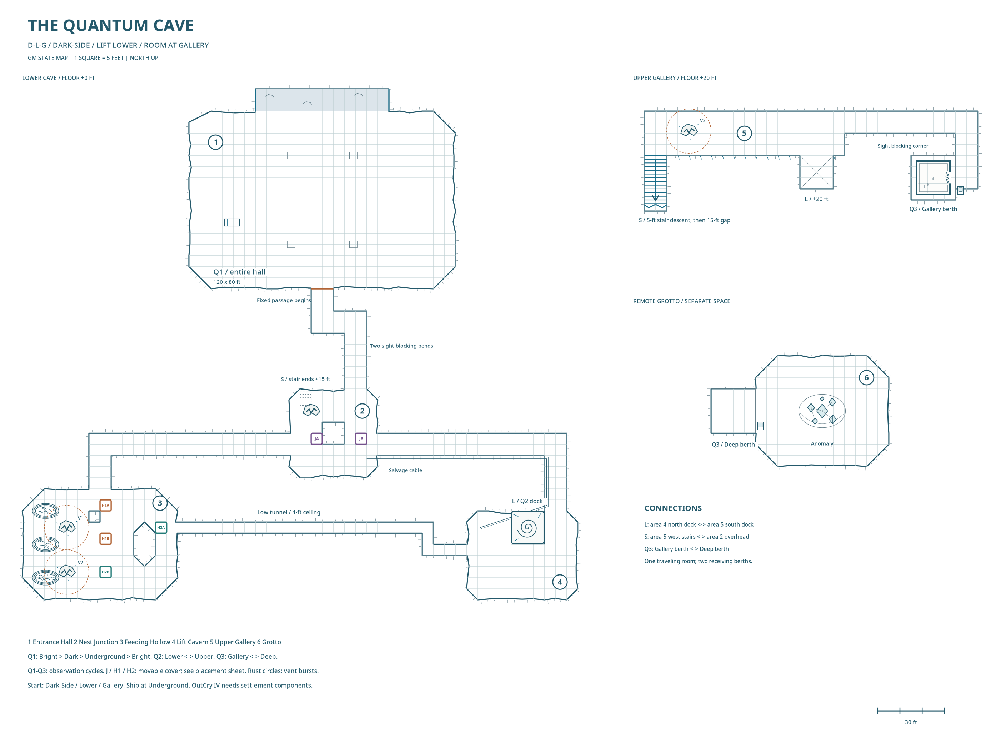
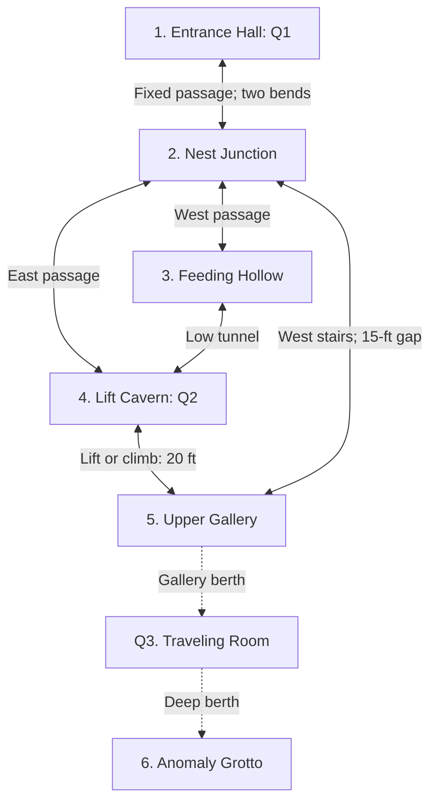
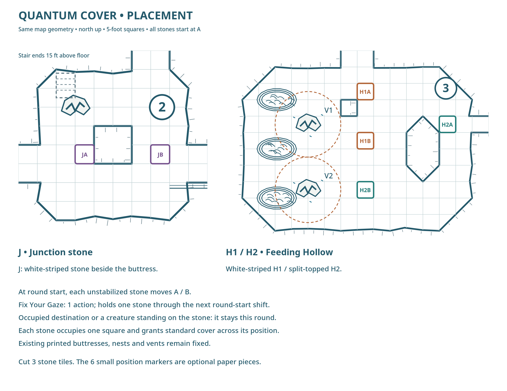

# Quantum Cave: GM Guide

==Quantum==

**Session 4 start:** Dark-Side entrance, Q2 Lower, Q3 Gallery. OutCry IV appears in Q1 Underground. The ship needs components now keeping Fresh-Breath habitable.

## Map and live tracker

**North is up in each panel.** L connects the lift docks; S connects the gallery stairs to the junction. The upper gallery and remote grotto have separate map panels. One square = 5 feet.

| Feature | Start / home | Current | Observer |
| --- | --- | --- | --- |
| Q1 Entrance Hall | Dark-Side | Dark-Side | |
| Q2 Lift Slab | Lower | Lower | |
| Q3 Traveling Room | Gallery | Gallery | |
| OutCry IV | Underground | Underground | |
| Maintenance case | Upper | Upper | |
| Junction stone J | A | A | |
| Hollow pillars H1 / H2 | A / A | A / A | |

## Connections

**Route to the anomaly:** 1 → 2 → 4 → 5 → Q3 → 6. Area 3 connects 2 and 4 by an alternate route. **Return from the vision:** 5 → west stairs and rope descent → 2 → 1. The lift provides another way down.

## Observation and movement

**Q1–Q3:** Seeing a recognizable part holds the entire feature. Once its final observer releases it, advance one state. Another shift requires a fresh observation-and-release cycle. Ordinary blinking maintains observation; deliberate eye-closing or looking away releases it. Darkvision and autonomous visual sensors count.

**Images:** Watching a clear live feed or current photograph holds the depicted feature. A photograph becomes stale after that feature changes. Each observer can watch one quantum feature at a time during encounters. Q3's camera relays its image to the viewer; its paired slates can recover the empty room.

**Passengers:** Everyone entirely inside Q1 or Q3, or supported by Q2, travels with it. A creature across the boundary, a secured tether, or an unsafe occupied destination blocks that shift. Fixed surroundings stay put.

**Exterior timing:** After the party leaves the Dark-Side entrance and observation ends, it moves Underground. Its natural resurfacing is Bright-Side in **1d4+1 days**, each 24 hours. For this revision, deliberate interior observation cycles remain immediate, allowing a return to Fresh-Breath for parts.

## 1. Entrance Hall: Q1

**120 × 80 feet. North:** exterior mouth. **South:** fixed two-bend passage to 2. Landing-gear impressions mark the central berth; a discarded boarding step lies by the west wall. The white mineral boundary encloses the quantum floor, walls, ceiling and exterior opening. The southern passage beyond it is fixed.

> The passage opens into a broad cavern, its floor marked by deep, evenly spaced impressions. A metal boarding step lies on its side nearby. A white mineral band crosses the floor and continues around the walls. At the back, a passage slopes downward, bending out of sight between close rock faces.

**Cycle:** Bright-Side → Dark-Side → Underground → Bright-Side. Bright and Dark open onto their respective surfaces. Underground opens against solid rock and contains **OutCry IV**, ramp lowered. After the party rounds the two bends and releases every view of Q1, its initial Dark-Side state advances to Underground.

> The white mineral band surrounds the same broad cavern, but a ship now fills the empty space. Its landing gear sits in the impressions, and its lowered boarding ramp nearly reaches the discarded step. Beyond its bow, the cave mouth opens against solid rock.

## 2. Nest Junction

**40 feet across. North:** two-bend passage to 1. **West:** passage to the north entrance of 3. **East:** passage to the northeast entrance of 4. **Overhead:** fixed stairs from 5 end 15 feet above the floor.

> The passage forks around a thick rock buttress. To the west, shredded cable insulation and curved flakes of shed skin litter a low opening. To the east, an abandoned cable follows the wall up a rising passage. Overhead, a broken staircase ends about fifteen feet above the floor. A pale crescent of mineral crust lies beneath it.

**Fixed:** central buttress, stairs, floor and exhausted vent crust. **Quantum:** the cracked, white-striped stone **J** shifts between the marked A/B squares beside the buttress when unobserved. The salvage cable follows the eastern passage. A rope from the broken stairs gives direct access to the gallery.

## 3. Feeding Hollow

**70 × 50 feet. North:** passage to 2. **East:** five-foot-wide, four-foot-high tunnel to 4. **West:** three nest shelves. The two printed buttresses, nests and vent fissures stay fixed.

> Low stone shelves line the western wall, their recesses packed with stripped wiring and shed scales. An electrovore crouches beside a pale fissure, scraping at its crust as blue sparks crawl between the stones. Farther along, dust trembles above a second fissure. A low tunnel opens in the eastern wall, partly concealed behind a rock buttress.

**V1:** upper western fissure. **V2:** lower western fissure. Their 10-foot bursts leave an eastern route between the north entrance and low tunnel. One visible electrovore feeds beside V1; additional creatures can shelter in the western nests. Powered equipment attracts them; they fly between shelves and feed on vent discharges.

**Quantum cover:** character-height pillars **H1** (white-striped) and **H2** (split-topped) each occupy one square. Their exact A/B positions appear on the placement map below. Both start at A.

## 4. Lift Cavern: Q2

**50 × 40 feet. Northeast:** passage to 2. **West:** low tunnel to 3. **North:** fixed cliff and gallery ledge, 20 feet up. The spiral-marked **15 × 15-foot slab** moves Lower ↔ Upper. Cliff, recess, floor and exits stay fixed.

> Two passages meet beneath a high stone ledge. A broad slab rests in a vertical recess below it, with a dark spiral fossil exposed across its surface. Matching mineral stains mark a space twenty feet above, level with the ledge. Beyond that ledge, a gallery continues into darkness.

**Ride:** board completely and release sight of the slab. It changes height once; looking at it again holds it for disembarking. The fixed cliff also permits climbing. At Upper, the yellow maintenance case appears on the slab.

> The spiral-marked slab now rests level with the upper ledge. A shallow recess marks its former position below. A battered maintenance case sits near its center, its yellow lid plainly visible against the stone.

## 5. Upper Gallery and Q3

**South:** Q2 dock. **West:** fixed stairs descend 5 feet, then end above the 15-foot gap to 2. **East:** a dogleg reaches Q3's Gallery berth; its corner blocks sight of Q2. **V3:** active vent near the western stairs.

> The gallery follows the edge of the cavern, overlooking the lift below. To the left, worn stairs descend toward the junction; pale mineral crust spreads across the stone beside their first few steps. To the right, the gallery bends around a corner. Beyond it, a small stone room stands within a wider alcove, its open doorway revealing a silver seam around the interior walls.

**Q3:** a 15-foot-square room in a 20-foot berth, with an east-facing doorway. Its floor, walls, ceiling and fitted curtain travel together **Gallery ↔ Deep**. Both berths and their surroundings stay fixed.

> The room is about fifteen feet across, with smooth walls and a continuous silver seam at waist height. Its single doorway has a heavy curtain hanging from a rail just inside. The floor is bare except for dust and several overlapping boot prints.

**Travel:** everyone enters, closes the curtain and releases sight of the room. Opening eyes holds it at arrival. **Empty-room recovery:** each berth has a viewing slate linked to Q3's interior camera. Watch the silver seam on the live feed, then look away to bring Q3 to the other berth. Another observer holding it keeps it there.

## 6. Anomaly Grotto

**60 × 50 feet. West:** Q3's Deep berth. **Center:** anomaly above a shallow depression. The grotto's floor and walls stay fixed.

> Pale blue light fills an enclosed cavern beyond the doorway. At its center, translucent facets hang around a brilliant white core, separating and turning before sliding back into alignment. The rock behind them appears displaced across their surfaces. Fine threads of light connect the outer fragments with faint, dry clicks, and a low vibration carries through the floor.

**Contact:** the whole team experiences the shared Star Dream vision and gains **Parted the Fabric** plus each character's assigned ability. Use the prepared vision in the session note, followed by this return:

> Your fingers meet cold stone. The silver seam runs around you at waist height, and your companions are beside you inside the small traveling room. Beyond its open doorway, the upper gallery is visible again. Small angular lights remain beneath your skin for another heartbeat, then fade.

**After contact:** everyone returns inside Q3 at Gallery. Its Deep destination becomes the empty replacement grotto, with its recovery slate. Future cycles reach that replacement.

> The doorway opens onto a small cavern of dark, bare stone. Your lights catch a low ceiling and a shallow depression in the floor. The silver seam of the traveling room ends at the threshold. Beyond it, the cavern’s walls curve together around the empty space.

## Moving cover and vents

**J, H1 and H2:** outside combat, each changes A ↔ B when its final observer looks away. During combat, each unstabilized stone changes at **the start of each round**. An occupied destination blocks that stone's shift for the round. The stones travel alone; a creature standing on one also blocks its movement. Each square blocks movement through it and provides standard cover when it lies between attacker and target. The printed stonework stays fixed.

#### Fix Your Gaze `pf2:1`

Choose a visible movable stone. It stays in place through the next round-start shift while you maintain line of sight. You can take other actions. Losing line of sight releases it; the effect ends after that shift.

**Chuckle Vents:** stepping on crust within 5 feet of a fissure, breaking it or forcefully disturbing it triggers a **10-foot burst, DC 17 basic Reflex, 2d6 electricity**. Reset: **10 minutes**. Trembling dust, comm interference and blue sparks precede eruptions. Electrovores are immune to electricity.

**Safe lull:** DC 14 trained Survival, observing from outside the burst for 1 minute, permits group crossing. **Discharge:** DC 17 trained Crafting, repair tools and conductive scrap, 2 actions adjacent; safe for 10 minutes. Failure leaves the vent active; critical failure triggers it. Remote crust-breaking triggers the eruption.

## Maintenance case and ship

The case belongs to **Q2 Upper**; OutCry IV belongs to **Q1 Underground**. Watching the object continuously carries it with its host as the host changes. A view of the object's interior or a valid image counts. The host's stone must be released for the host to shift.

If observation ends while the object is away from home and still on its host, the object returns home with its occupants. The host keeps its current state. Fully carrying the case off Q2, or flying the ship beyond Q1's boundary, ends that binding.

**Case experiment:** reach Upper → watch the case and release the slab → descend with the case → look away while it remains on the slab → the case returns to Upper. Carrying it off the slab keeps its ordinary maintenance fittings available.

## OutCry IV: repairs and escape

**Inspection:** empty equipment mounts, disconnected services and stripped systems show that the ship was dismantled. Fresh-Breath uses the missing components to remain habitable. The most feasible full repair requires recovering those components, making evacuation and dismantling the settlement part of the same job.

**Local salvage:** the case, abandoned cable and party's wreck can provide fittings and partial repairs. Essential systems still require settlement components. The Drift Eikon option also requires a survivable hull and enough restored systems to sustain the passengers during uncontrolled Drift travel. Specific repair jobs and DCs remain to be set after inspection.

**Return for parts:** cycle Q1 Underground → Bright-Side → Dark-Side through separate observation-and-release cycles. The southern passage always connects to the deeper cave.

**Launch:** repair and board in Underground → watch the ship's interior → close ramp, disconnect tethers and cover exterior views → release every view or valid image of Q1 → Q1 changes to Bright-Side with the ship → hold both ship and hall while opening cockpit views → fly fully beyond the boundary.

## Music

Exploration: **The Uncertainty Principle**. Electrovore combat: **Robot Getaway**. Anomaly reveal: **The Nomai**. Shared vision: **The Ash Twin Project**. Full Spotify links and Fresh-Breath cues are in [Session-4-Music.md](Session-4-Music.md).
