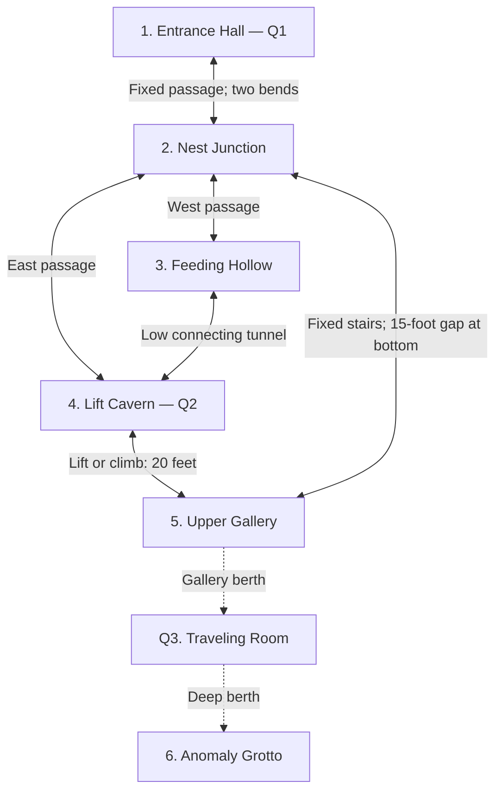

# Quantum Cave — Session 3 GM Guide

==Quantum==

**Purpose:** Find the missing settlers’ ship, learn to control the cave’s changes, encounter the anomaly, and bring the repaired ship to the surface.

**Working layout for tonight:** Six numbered areas, three quantum features, and two objects with a special observation rule. This page consolidates the revised layout. The state-bound ship and maintenance case are encounter-specific additions to [[Quantum]].

## Start here

At Fresh-Breath, someone tells the team: “Our ship is at the mouth of the cave. The boarding ramp was down when we left it.” The party arrives at an empty berth. Their exploration reveals that observation holds features in place, that passengers can travel with them, and that an observed object can be carried out of its home configuration.

**Likely route:** Entrance → Junction → Lift Cavern → Upper Gallery → Anomaly → Upper Gallery → Junction → Entrance → Ship.

**Side route:** Junction → Feeding Hollow → Lift Cavern. The feeding hollow contains the main nests and provides an alternate approach.

**Escape:** Find the ship in Underground → board and repair → maintain observation of the ship → release observation of Q1’s stone → shift to Bright-Side → observe the entrance again → launch.

### Live tracker

| Feature | Starting state | Current state | Watcher / image / tether |
| --- | --- | --- | --- |
| **Q1 — Entrance Hall** | Bright-Side; empty berth | Bright-Side | |
| **Q2 — Lift Slab** | Lower; bare slab | Lower | |
| **Q3 — Traveling Room** | Gallery berth | Gallery | |
| **Ship** | Home state: Underground | Underground | |
| **Maintenance case** | Home state: Upper | Upper | |

- [ ] Party has seen a feature change.
- [ ] Party has traveled with a feature.
- [ ] Party has tested the maintenance case’s observation rule.
- [ ] Anomaly contacted; heritage and assigned abilities granted.
- [ ] Q3’s Deep destination replaced by the empty grotto.
- [ ] Ship repaired and ready to launch.

**Initial setup:** The features begin in the states above. Their first release occurs after someone has observed them. Electrovores begin in the fixed nesting areas, with their sightlines confined to those areas.

## Map and connections

**Solid lines:** Physical routes. **Dotted lines:** Q3’s two possible locations. Q3 occupies one berth at a time. The diagram shows connectivity; room dimensions and elevation appear below.

### What is fixed, and what changes?

| Location              | Quantum extent                                                                                | Fixed surroundings                                                        |
| --------------------- | --------------------------------------------------------------------------------------------- | ------------------------------------------------------------------------- |
| **1. Entrance Hall**  | Q1: the hall’s floor, walls, ceiling, and exterior opening, within its white mineral boundary | The southern passage beyond the boundary; all passages deeper in the cave |
| **2. Nest Junction**  | None                                                                                          | Floor, fork, buttress, spent vent, and broken staircase                   |
| **3. Feeding Hollow** | None                                                                                          | Nest shelves, vents, pillars, and both exits                              |
| **4. Lift Cavern**    | Q2: the spiral-marked slab alone                                                              | Cliff, recess, floor, upper ledge, and passage mouths                     |
| **5. Upper Gallery**  | Q3’s stone room, when it occupies its berth                                                   | Gallery, stairs, side alcove, and berth beneath the room                  |
| **6. Anomaly Grotto** | Q3’s stone room, when it occupies its berth; the anomaly has its own scripted contact effect  | Grotto, depression, and room berth                                        |

**Q1’s geography:** Its southern doorway always joins the same fixed passage. Its exterior opening connects to three different locations on the moon. Treat this as a quantum connection through space. The deeper cave keeps the layout shown above.

## Observation procedure

When a player’s action could release a feature:

1. Identify the feature and its current state.
2. Check every direct observer, active visual sensor, and watched valid image.
3. Check for a creature crossing its boundary, an attached tether, or an obstructed destination.
4. Tell the player which feature their action would release.
5. When the final observation ends and movement is possible, advance **one state**. Carry eligible passengers and equipment.
6. Wait for a fresh observation-and-release cycle before advancing again.

**Ordinary blinking maintains observation.** Deliberately looking away, closing eyes, or losing visibility releases it. Seeing any recognizable part of a feature holds the whole feature. Darkvision and active artificial vision count. Light supplies visibility; a creature or visual observer supplies observation.

**Images:** A watched clear photograph or live feed holds the depicted feature. A photograph must show its current configuration and becomes stale after that feature shifts. An image of the ship’s cabin depicts the ship; an exterior view that includes Q1’s recognizable stone can also observe the hall. During encounters, each observer maintains watch over one quantum feature at a time, following [[Quantum]].

**Passengers:** Creatures and loose objects entirely inside Q1 or Q3, or entirely supported by Q2, travel with that feature. Worn and carried gear accompanies them. The ship and maintenance case use the additional rule in their section below.

**Blocked movement:** A boundary-straddling creature or secured tether holds the feature. An unsafe or occupied destination prevents that attempted shift. Resolve the obstruction, then use a fresh observation-and-release cycle.

### Sightline checkpoints

| Position | What can be observed |
| --- | --- |
| Inside the Entrance Hall | Q1’s stone; the ship when present |
| Beyond the entrance passage’s second bend | Fixed passage and junction |
| Nest Junction or Feeding Hollow | Fixed terrain; Q2 becomes visible only after entering the Lift Cavern |
| Lift Cavern or gallery overlook | Q2; its surrounding cliff is fixed |
| Beyond the gallery’s eastern corner | Q3’s Gallery berth; the corner blocks the view of Q2 |
| Inside Q3 with eyes open | Q3’s interior; potentially the surroundings through its doorway |
| Inside the ship with ramp closed and exterior views covered | The ship’s interior |

## 1. Entrance Hall — Q1

**Size:** Approximately 120 × 80 feet; enlarge to fit the chosen vessel and a clear launch path. **North:** exterior opening. **Center:** ship’s berth. **South:** passage to Junction, with two bends. **West wall:** discarded boarding step.

### Read aloud — first arrival

> The passage opens into a broad cavern, its floor marked by deep, evenly spaced impressions. A metal boarding step lies on its side nearby. A white mineral band crosses the floor and continues around the walls. At the back, a passage slopes downward, bending out of sight between close rock faces.

### States

| State | What is beyond the north opening? | Ship in its home configuration |
| --- | --- | --- |
| **Bright-Side** | Daylit surface and a ship-sized opening | Empty berth |
| **Dark-Side** | Dark surface and the same opening | Empty berth |
| **Underground** | Solid rock beyond the opening; the hall remains spacious | Ship in berth, ramp lowered |

**Cycle:** Bright-Side → Dark-Side → Underground → Bright-Side.

**Recognition:** The white mineral band identifies Q1. Landing-gear impressions preserve the ship’s position across configurations. Seeing any of Q1’s floor, walls, ceiling, or opening holds its state.

**First departure:** Once everyone rounds the second bend and releases all images, Bright-Side advances to Dark-Side. It stays there until observed and released again. Their eventual return reveals the dark exterior. One further cycle reveals Underground and the ship, unless their earlier actions have advanced the tracker differently.

### Read aloud — Underground

> The white mineral band surrounds the same broad cavern, but a ship now fills the empty space. Its landing gear sits in the impressions, and its lowered boarding ramp nearly reaches the discarded step. Beyond its bow, the cave mouth opens against solid rock.

**Route forward:** Southern passage → Junction. **Route out:** North opening in a surface state. The opening’s dimensions provide safe flight clearance.

## 2. Nest Junction — fixed

**Size:** About 40 feet across. Entering from Q1, the party faces the central buttress. **Left/west:** Feeding Hollow. **Right/east:** Lift Cavern. **Overhead:** return staircase from the gallery, ending 15 feet above the floor.

### Read aloud

> The passage forks around a thick rock buttress. To the left, shredded cable insulation and curved flakes of shed skin litter a low opening. To the right, an abandoned cable follows the wall up a rising passage. Overhead, a broken staircase ends about fifteen feet above the floor. A pale crescent of mineral crust lies beneath it.

**Vent here:** Old, exhausted crust. Treat it as a visible sign of the environment. The three active vents are in areas 3 and 5.

**Navigation clues:** The abandoned cable follows the right-hand route. Electrical crackling and animal movement come from the left. From above, a rope secured to the staircase provides a direct return route. Characters can also attempt to climb up from below.

## 3. Feeding Hollow — fixed

**Size:** About 70 × 50 feet. **South:** Junction passage. **East:** low tunnel to Lift Cavern. **West:** nesting shelves. Rock buttresses divide the floor and offer cover.

### Read aloud

> Low stone shelves line the far wall, their recesses packed with stripped wiring and shed scales. An electrovore crouches beside a pale fissure, scraping at its crust as blue sparks crawl between the stones. Farther along, dust trembles above a second fissure. A low tunnel opens in the wall to your right, partly concealed behind a rock buttress.

**Placement:** Put one active vent beside the front nesting shelf and the second farther north. Leave a continuous route outside their 10-foot eruption areas along the eastern side. The creatures can fly between shelves.

**Default behavior:** One visible electrovore feeds here. Other nesting activity remains deeper in the crevices. Show the feeding creature provoking a discharge and absorbing it. It investigates nearby electrical equipment and retreats toward its shelf after feeding or taking significant injury. Use [[Electrovore]] for statistics and electricity immunity.

**Choices:** Slip along the eastern wall, use a powered lure, interact with the vents, confront the feeding animal, or return through the Junction. A creature entering area 4 can observe Q2 with darkvision; track that explicitly if it happens.

## 4. Lift Cavern — Q2

**Size:** About 50 × 40 feet. **South:** Junction passage. **West:** Feeding Hollow tunnel. **North:** fixed cliff and upper ledge, 20 feet high. A 15 × 15-foot slab moves within a vertical recess.

### Read aloud — Lower

> Two passages meet beneath a high stone ledge. A broad slab rests in a vertical recess below it, with a dark spiral fossil exposed across its surface. Matching mineral stains mark a space twenty feet above, level with the ledge. Beyond that ledge, a gallery continues into darkness.

| State | Slab location | Maintenance case at home |
| --- | --- | --- |
| **Lower** | Flush with cavern floor | Absent from slab |
| **Upper** | Flush with upper ledge, 20 feet above floor | Resting on slab |

**Cycle:** Lower ↔ Upper. **Quantum extent:** slab alone, including its fossil and edges. **Fixed:** cliff, ledge, recess, and passages.

**Ride:** Board entirely, release every observer’s view of the slab, then arrive in the other position. Passengers can open their eyes and hold it while stepping off. Climbing the fixed cliff provides another route.

### Read aloud — first Upper state

> The spiral-marked slab now rests level with the upper ledge. A shallow recess marks its former position below. A battered maintenance case sits near its center, its yellow lid plainly visible against the stone.

**Teaching opportunity:** Let the party notice both the slab’s change and the case’s appearance. Testing the case demonstrates the observation rule they will use with the ship. See the next section.

## The maintenance case and ship

**Encounter rule: state-bound objects.** The case’s home configuration is **Q2 Upper**. The ship’s home configuration is **Q1 Underground**. Each initially appears only in its home configuration.

**Continuous observation preserves an object while its surrounding feature changes.** Watching an object's interior or a valid image counts. The observer must release their view of the surrounding quantum stone to let that stone shift.

**If observation of the object ends away from home:** It returns to its home configuration. The surrounding feature keeps its current state. Creatures and loose contents inside the ship travel with it; they can recover access by bringing Q1 to Underground. Fully removing the object from its host feature ends this state-bound effect. For the case, carry it completely off Q2. For the ship, fly it fully beyond Q1’s exterior boundary.

### Case experiment

1. Q2 reaches Upper, revealing the yellow case.
2. The party watches the case while releasing observation of the slab. A tightly framed live view or photograph of the case helps isolate what they are observing.
3. Q2 moves Lower and carries the observed case with it.
4. If they release the case while it remains on the slab, it returns to Upper. Q2 remains Lower until its own next cycle.
5. They can repeat the experiment, then carry the case off the slab to keep it. It contains ordinary maintenance fittings useful for the ship repairs.

**If they need a clue:** Describe the two separate changes plainly: the stone moved, and the case appeared or disappeared. Once they have seen enough to infer the rule, summarize their successful experiment in direct terms.

## 5. Upper Gallery — fixed, with Q3 berth

**South:** lift overlook. **West:** stairs toward the Junction. **East:** bend into a side alcove. A 20-foot-wide fixed berth accommodates Q3’s 15-foot-wide room. The bend blocks sight between Q2 and Q3.

### Read aloud — Q3 present

> The gallery follows the edge of the cavern, overlooking the lift below. To the left, worn stairs descend toward the junction; pale mineral crust spreads across the stone beside their first few steps. To the right, the gallery bends around a corner. Beyond it, a small stone room stands within a wider alcove, its open doorway revealing a silver seam around the interior walls.

**Active vent:** Beside the first stairs, with room to pass outside its eruption area or disable it. The staircase itself is fixed. At the bottom, a 15-foot gap separates the last step from the Junction floor.

**When Q3 is away:** The alcove contains a bare berth. Its outline and dust marks show where the room stood. Q3’s occupants or an observer at its Deep berth must release it for it to return. If the team released it here while staying outside, they can reach it only by a return cycle from the far end or another established observation method. Warn them of that consequence before they deliberately send the empty room away.

## Q3 — Traveling Room

### Read aloud — inside

> The room is about fifteen feet across, with smooth walls and a continuous silver seam at waist height. Its single doorway has a heavy curtain hanging from a rail just inside. The floor is bare except for dust and several overlapping boot prints.

**Extent:** Entire enclosed stone room: floor, walls, ceiling, doorway, and fitted curtain. **Cycle:** Gallery ↔ Deep. **Passengers:** Creatures and loose objects entirely inside.

| State | Occupied berth | Other berth |
| --- | --- | --- |
| **Gallery** | Upper Gallery side alcove | Bare recess in area 6 |
| **Deep** | Anomaly Grotto recess | Bare alcove beside Upper Gallery |

**Travel procedure:** Everyone enters, pulls the curtain closed, and releases sight of the room. Darkvision users close their eyes. Q3 moves once. Opening their eyes holds it; drawing the curtain reveals the destination.

**Keeping access:** A designated watcher can hold Q3 while others inspect the grotto. Someone standing across the threshold also anchors it under [[Quantum]]. Tell players when they are about to release the room that provides their return route.

**Empty-room recovery, prepared for tonight:** Fit a small ordinary camera inside Q3 with a paired viewing slate mounted at each berth. The feed frames the silver seam. Watching the feed establishes observation; looking away releases it. If Q3 travels empty, the slate gives the party a way to call it back. Treat this as abandoned maintenance equipment; its power indicator and live image are visible at the berth. The camera transmits the view for the viewer; declare it a passive relay, with observation supplied by the watching creature. Active autonomous visual observers follow the normal drone rule.

## 6. Anomaly Grotto

**Placement:** Q3’s berth lies beside the western wall. The anomaly hangs over a shallow depression in the center. The grotto is otherwise fixed and enclosed. Its light reaches Q3 through an open doorway.

### Read aloud — discovery

> Pale blue light fills an enclosed cavern beyond the doorway. At its center, translucent facets hang around a brilliant white core, separating and turning before sliding back into alignment. The rock behind them appears displaced across their surfaces. Fine threads of light connect the outer fragments with faint, dry clicks, and a low vibration carries through the floor.

**Contact:** Once someone touches the anomaly while the team is gathered here, run the shared vision. All four gain **Parted the Fabric** and the individual ability you assign. Use the interaction passage in [[Session 3]]; its final return paragraph is replaced below to match this layout.

### Read aloud — returning from the vision

> Your fingers meet cold stone. The silver seam runs around you at waist height, and your companions are beside you inside the small traveling room. Beyond its open doorway, the upper gallery is visible again. Small angular lights remain beneath your skin for another heartbeat, then fade.

**Event update:** Q3 returns with the team to Gallery. Its future Deep destination becomes an empty replacement grotto. The anomaly chamber drops out of its accessible cycle. Resolve this scripted transition when contact occurs, then resume the ordinary observation rules. Retarget the Deep berth and its recovery slate to the replacement grotto.

### Read aloud — replacement grotto, if checked

> The doorway opens onto a small cavern of dark, bare stone. Your lights catch a low ceiling and a shallow depression in the floor. The silver seam of the traveling room ends at the threshold. Beyond it, the cavern’s walls curve together around the empty space.

**Way back to the ship:** Gallery → western stairs and rope descent → Junction → two-bend passage → Entrance Hall. Let further tests of Q3 confirm its new two-state cycle, then summarize repetitions.

## Chuckle Vents — quick reference

Use [[Chuckle Vent]]. **Hazard 1, simple.** ==Electricity== ==Environmental==

**Placement:** Two in Feeding Hollow; one beside Upper Gallery stairs. The Junction crust is exhausted.

**Warning signs:** Trembling dust, comm interference, and blue sparks on pale crescent-shaped crust. **Stealth:** 14.

**Trigger:** Step on crust within 5 feet of the fissure, break it, or forcefully disturb it. **Eruption:** 10-foot burst, **DC 17 Reflex**, **2d6 electricity**; critical success unaffected, success half, failure full, critical failure double.

**Safe crossing:** Trained Survival **DC 14**, observing from outside the eruption area for **1 minute**, identifies a safe lull for the group. **Discharge:** Trained Crafting **DC 17**, repair tools and conductive scrap, **2 actions adjacent**; safe for **10 minutes**. Failure has no effect; critical failure triggers Eruption. Remote crust-breaking also triggers the eruption. **Reset:** 10 minutes.

## Repair and departure

These are proposed repair jobs for tonight. Reveal all three through a successful diagnostic inspection and let the team distribute the work. Use your usual level-appropriate DCs and repair durations.

| Job | Evidence | Available solution |
| --- | --- | --- |
| Restore feeder cable | Stripped insulation and a severed connection | Cut and fit a usable section of the abandoned maintenance cable |
| Restore coolant circuit | Drained reservoir and cracked coupling | Coolant stored aboard; compatible fitting from the case or ship’s maintenance locker |
| Clear startup isolation fault | Diagnostic display identifies the isolated section | Close the repaired circuit and bring systems online in stages; Chief can assist if present |

Keep progress earned. Failed attempts can cost repair time or a spare fitting. Describe diagnostic changes so the party can tell what remains to be done.

**Startup complication:** One electrovore investigates the new power through an open service panel. Further movement is audible down the entrance passage. Adjust the number joining the encounter to the party’s level and remaining resources. Creatures favor feeding and withdrawal. Account for any creature with a view of Q1 when the team attempts extraction.

### Launch checklist

1. Reach **Q1 Underground** and find the ship.
2. Board, repair, and assign a ship watcher. A crew member looking at cabin fixtures maintains the ship’s presence.
3. Bring everyone and their gear aboard. Disconnect ground tethers, close the ramp, and close service panels.
4. Cover windows, stop viewing exterior feeds, and release any valid images of Q1. Confirm that remaining outside observers have also released the hall.
5. Q1 advances **Underground → Bright-Side**. The observed ship accompanies it.
6. Reveal the cockpit view. Assign one observer to Q1 and another to the ship if operating in encounter turns.
7. Launch through the broad opening. Once the ship is fully clear, end its state-bound effect.

## Music cues

| Moment | Cue |
| --- | --- |
| Cave exploration and quantum experiments | The Uncertainty Principle — Andrew Prahlow |
| Anomaly first revealed | The Nomai — Andrew Prahlow |
| Contact and shared vision | The Ash Twin Project — Andrew Prahlow |
| Return to the gallery | Fade out for the immediate reaction; resume exploration music when they move |

## Fast rulings

**Someone keeps watching:** That feature stays in its current state. Ask who maintains each watch when the group splits.

**Someone looks at fixed rock:** Only the relevant quantum feature’s recognizable surfaces establish observation of it.

**Party splits between rooms:** Track each feature independently. Fixed corridors preserve the map. The camera slates provide recovery access to Q3; ropes and the stairs provide alternatives to Q2.

**A companion, drone, or electrovore watches:** Apply the same visibility rule. The electrovore’s darkvision supplies visual observation; its imprecise electricsense locates electrical activity.

**A destination is obstructed:** Keep the current state and explain the physical obstruction when discoverable. Try again after clearing it and observing/releasing the feature.

**They solve the entrance early:** Let them find the ship. Repairs and the nesting ground remain available encounters; the anomaly remains a discoverable side destination. Follow their chosen route.

**They lose the ship away from Underground:** Return it and anyone aboard to its home configuration. Characters outside recover it by cycling Q1 to Underground. Characters aboard can maintain observation of the cabin while awaiting reunion.

**They understand a cycle:** Write its states where everyone can see them and resolve routine repeated travel quickly.
